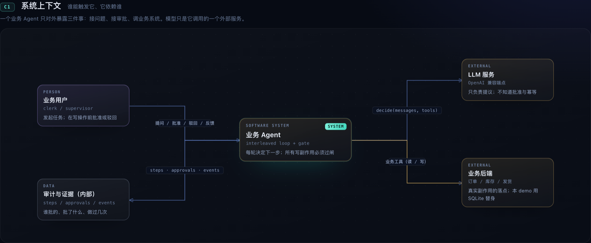
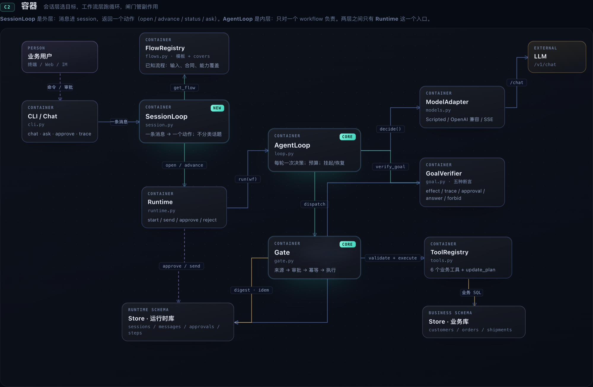
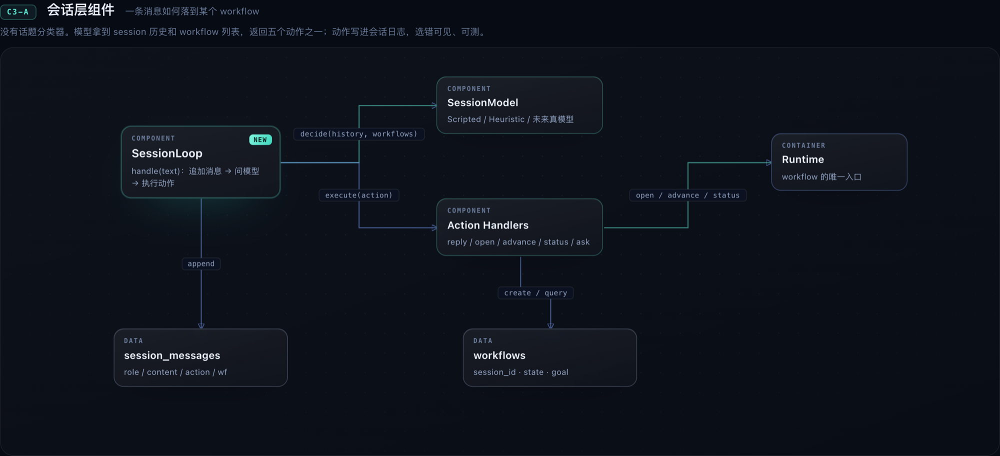
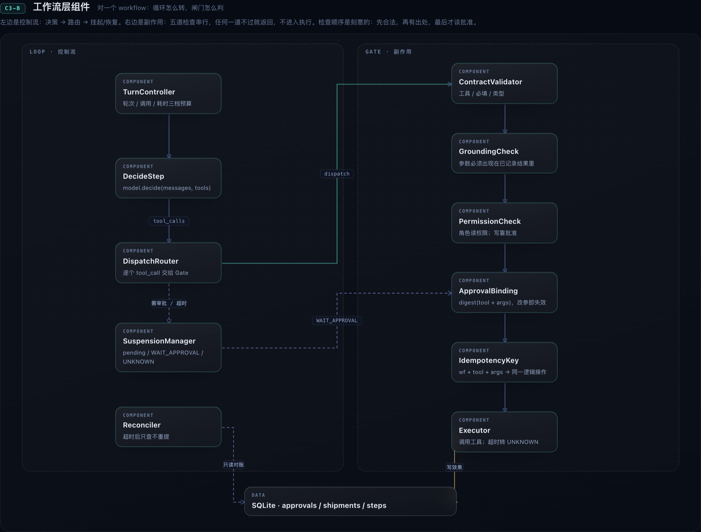
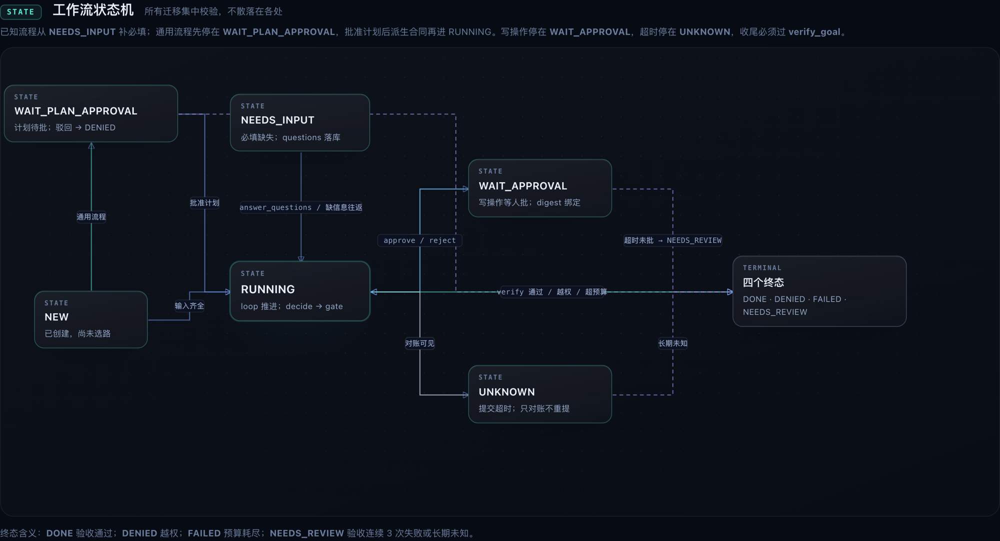
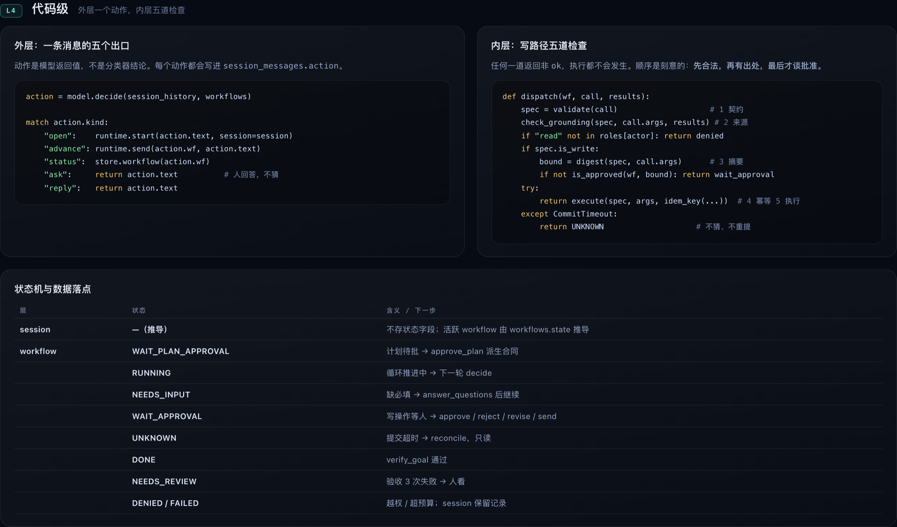

# busagent

**业务 Agent 学习型 MVP**：interleaved loop + 写闸门 + 目标验收。

> 一句话链路：**session 选目标 → flow / plan 给合同 → loop 逐步决策 → gate 管副作用 → verify_goal 判完成 → 状态机管迁移。**

`Python 3.10+` · 零第三方依赖 · 36 tests · 7 个 demo 场景 · 1 个已知流程

**这个项目是做什么的**：用一个能跑通的极小业务场景（订单缺件补发），把「业务 Agent」拆成可观察、可测试的六层——会话选目标、流程给合同、循环做决策、闸门管副作用、验收判完成、状态机管迁移。适合照着跑、照着改坏、再解释清楚。

> 仓库：[github.com/ogj130/one-mini-agent](https://github.com/ogj130/one-mini-agent)


## 它是什么

模型每一轮只决定**下一步动作**；能不能执行由闸门决定；做没做完由合同验收。
代码里没有「Planner 对象」，计划只是循环里的一个工件。

这同时是一个**可验证**的最小系统：写操作有审批摘要与幂等键，提交超时进 `UNKNOWN`，恢复只对账不重提。

## 30 秒跑起来

```bash
cd one-mini-agent
python3 -m busagent demo                  # 7 个场景 + 红线，exit 0
python3 -m unittest discover -s tests -v  # 36 tests
```

数据在 `.busagent-data/agent.db`；`python3 -m busagent reset` 清空。

## 三个入口

| 入口 | 适用 | 命令 |
|---|---|---|
| **通用问句** | 临时任务 | `ask → approve → resume` |
| **已知流程** | SOP 型业务 | `flow → answer → approve → resume` |
| **通用计划** | 无法预定义的目标 | `plan → approve-plan → approve → resume` |
| **会话模式** | 多目标并存 | `chat` |

### A. 通用问句

```bash
python3 -m busagent ask "张三的订单 1001 缺什么，帮我补发"
# → WAIT_APPROVAL（写操作被扣住）
python3 -m busagent approve wf_x --as supervisor
python3 -m busagent resume wf_x
python3 -m busagent trace wf_x          # 看 messages / steps / events
```

### B. 已知流程（模板 + 必填追问 + 覆盖检查）

```bash
python3 -m busagent flows
python3 -m busagent flow shipment.reship \
  --input customer_name=张三 \
  --request "张三的订单 1001 需要补发 MUG-WHITE"
# → NEEDS_INPUT：列出 order_id / sku
python3 -m busagent answer wf_x order_id=1001 sku=MUG-WHITE
python3 -m busagent approve wf_x --as supervisor
python3 -m busagent resume wf_x
```

请求超出流程 `covers`（例如“补发并通知客户”）默认**拒绝并列出缺口**；
加 `--partial` 才执行已覆盖部分，答案会注明「未覆盖 X，需要另走一步」。

### C. 通用计划（先批计划，再派生合同）

```bash
python3 -m busagent plan "张三的订单 1001 需要补发 MUG-WHITE"
# → WAIT_PLAN_APPROVAL，6 个计划项，每项带断言类型
python3 -m busagent approve-plan wf_x --as supervisor
# → 派生 contract，转 RUNNING
python3 -m busagent reject-plan wf_x --reason "不做"
# → DENIED，零写入
```

计划项没有可执行断言，`derive_contract` 直接拒绝；合同由计划机械派生。

### D. 会话模式

```bash
python3 -m busagent chat
你> 张三的订单 1001 缺什么，帮我补发
你> 补错东西了，应该补杯盖
你> /new 李四的订单 1002 缺什么，帮我补发
你> /status
```

一个 session 里可以有多个 workflow；旧 workflow 不会被静默取消。

## 架构图

C4 分四层 + 状态机 + 代码级，每张单独点开看。交互版（缩放不错位）见 [c4-architecture.html](c4-architecture.html)。

### C1 · 系统上下文



用户、业务 Agent、LLM、业务后端、审计证据：先看边界。

### C2 · 容器



`SessionLoop` 选目标，`AgentLoop` 跑循环，`Gate` 管副作用，`GoalVerifier` 判完成。

### C3-A · 会话层组件



一条消息 → 一个动作（reply / open / advance / status / ask），不做话题分类。

### C3-B · 工作流层组件



左边控制流，右边五道检查；任何一道不过都不进入执行。

### 状态机



迁移集中在 `states.py`，终态不可重启。

### L4 · 代码级



外层 `match action.kind`，内层 `dispatch` 五道检查。

## 核心机制

```text
turn n: model.decide(messages, tools)
          │
          ├─ 无 tool_calls → verify_goal（合同验收）→ DONE / NEEDS_REVIEW
          └─ tool_calls → Gate.dispatch
                            ├─ 契约校验 / 来源校验 / 权限
                            ├─ 写操作 → 审批摘要 → 幂等键 → 执行
                            │            ├─ 未批准 → WAIT_APPROVAL
                            │            └─ 超时   → UNKNOWN（只对账）
                            └─ 结果写回 messages → 下一轮
```

- **计划是工件，不是触发器**：`update_plan` 只写 `workflows.plan`，执行权始终在 Gate。
- **审批绑定参数摘要**：改一个字，digest 变，旧批准失效。
- **幂等键由运行时注入**：同一 workflow + 同一工具 + 同一参数 = 同一逻辑操作。
- **超时 ≠ 失败**：`UNKNOWN` 只查不重提，对账可见后才 `DONE`。
- **验收不调模型**：`effect / trace / approval / answer / forbid` 五种断言。

## 状态机

```text
NEW
 ├─> RUNNING ──> WAIT_APPROVAL ──> RUNNING
 │      │            └─> UNKNOWN ──> RUNNING
 │      ├─> NEEDS_INPUT ──> RUNNING
 │      └─> DONE / DENIED / FAILED / NEEDS_REVIEW
 ├─> NEEDS_INPUT              （已知流程缺必填）
 └─> WAIT_PLAN_APPROVAL ──> RUNNING / DENIED
```

迁移集中在 `states.py` + `Store.transition()`；终态再次 resume 直接返回，不会重启。

## 目录

```text
busagent/
  contracts.py   工具契约 / 消息 / 严格校验
  store.py       SQLite：业务表 + sessions/workflows/messages/approvals/steps
  tools.py       6 个业务工具 + update_plan
  gate.py        来源 → 审批 → 幂等 → 执行 → UNKNOWN
  loop.py        每轮一次决策；预算；挂起/恢复；验收接入
  goal.py        五种断言的 GoalVerifier
  states.py      状态机与合法迁移
  session.py     会话层：reply / open / advance / status / ask
  flows.py       已知流程模板 + covers 覆盖检查
  plan.py        计划提案 + 合同派生
  models.py      Scripted / OpenAI 兼容 / SSE
  runtime.py     门面：start / send / flow / plan / approve
  events.py      Event / EventSink / EventLog
  cli.py         demo、chat、flow、plan、trace
tests/           36 条测试
```

## 文档

| 文档 | 用途 |
|---|---|
| [MVP.md](MVP.md) | 学习型 MVP 的范围、10 个实验、5 个自测问题 |
| [READING.md](READING.md) | 20 分钟读码路线 + 依赖顺序 |
| [c4-architecture.html](c4-architecture.html) | C4 交互架构图（C1/C2/C3-A/C3-B/STATE/L4） |
| [assets/](assets/) | README 分图、banner 源文件 |

## 演示场景（`demo`）

| 场景 | 证明什么 |
|---|---|
| A 正常 | 提交被扣在 `WAIT_APPROVAL`，批准后恰好 1 条 |
| B 改参数 | 摘要变了，旧批准自动失效，零写入 |
| C 越权 | `intern` 无读权限；`clerk` 不能自批 |
| D 拒绝→修正 | 错误调用回灌，下一步自己改对 |
| E 超时 | `UNKNOWN` 只对账，不重提 |
| G 驳回重提议 | 反馈进对话，旧批准作废 |
| F 预算 | 原地打转会被轮次上限停住 |

## 不做什么

不接真模型（`ScriptedModel` 是确定性替身）、不做多租户 / 并发租约 / 上下文压缩 / 重试退避 / OTel、不做审批 UI 与真实业务系统。
这些属于生产化，见 [MVP.md](MVP.md#不做什么刻意留白)。

## 接真模型

```python
from busagent.models import OpenAICompatibleModel
from busagent.runtime import Runtime

rt = Runtime(".busagent-data", actor="clerk",
             model=OpenAICompatibleModel.from_env())
wf = rt.start("张三的订单 1001 缺什么，帮我补发")
```

`ScriptedModel` 与真模型实现同一个 `decide(messages, tools) -> Decision` 协议，闸门与验收一行不用改。
